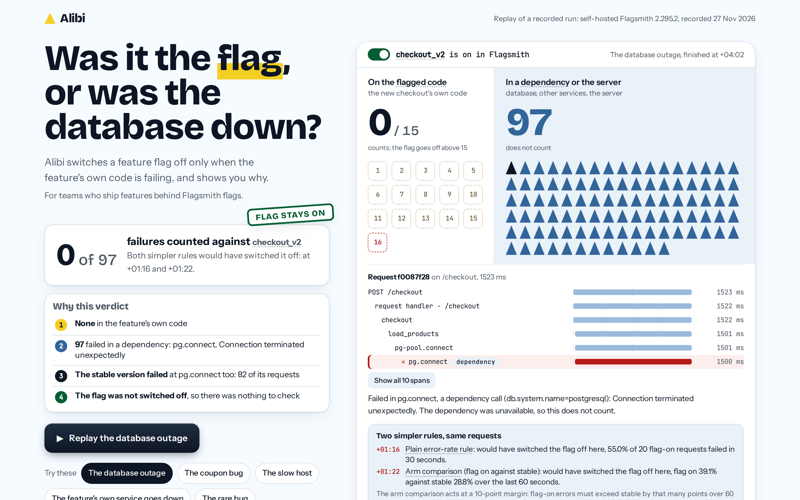
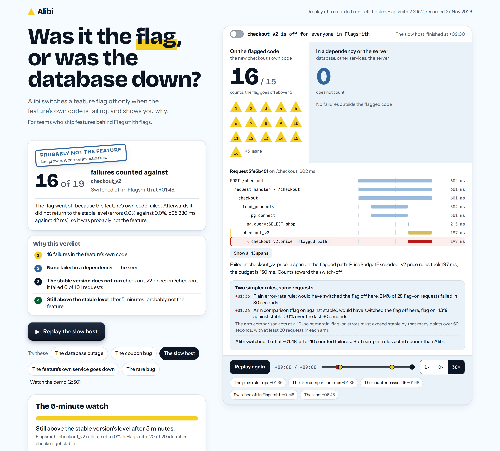
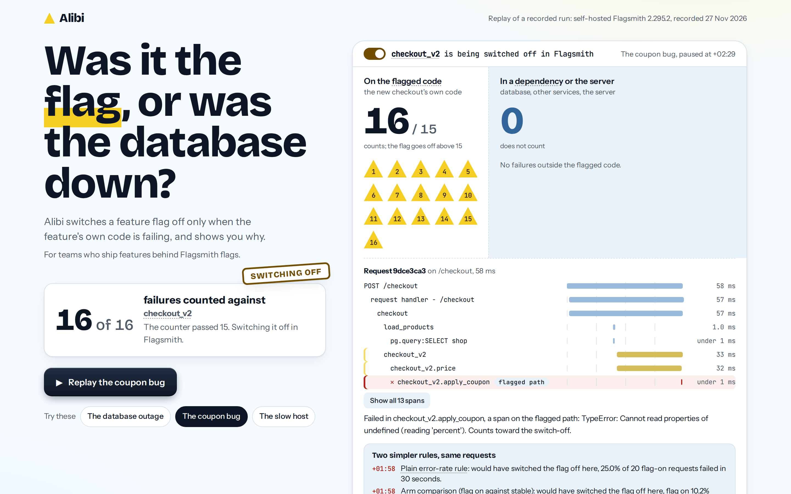
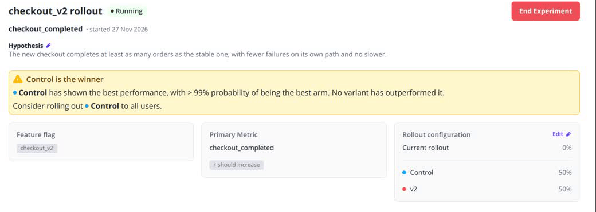
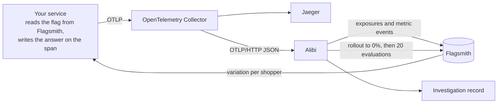

# Alibi: was it the flag, or was the database down?

Alibi switches a Flagsmith feature off only when the feature's own code is failing, and tells you why it thinks so. It reads the OpenTelemetry traces your service already sends. For teams who ship features behind Flagsmith flags.

[](https://itssaharsh.github.io/alibi/)

**[Live page](https://itssaharsh.github.io/alibi/)** (no sign-in; recorded runs replayed in your browser) · **[Demo video](https://itssaharsh.github.io/alibi/alibi-demo.mp4)** (2:50) · **[Run it yourself](#quickstart-run-it-yourself)** (three commands) · Track 03, Build on Open Source Flagsmith

**In 24 runs whose scenarios and scoring were committed before any of them ran (outages of a shared service, of a service only the feature calls, a flaky database, bugs in the feature), Alibi made the right call 24 times. A rule that compares the two versions at a 20-point margin made it 17 times.** Three of those runs turn on what you call infrastructure: leave them out and it is 21 of 21 against 17 of 21; score them the other way and it is 21 against 20. On the 18 runs before these the two rules tie. [The numbers](#the-numbers-against-two-simpler-rules) say all of it.

## The problem

You put a new checkout behind a flag for half your shoppers. Twenty minutes later the error graph jumps, and a kill switch that watches the error rate switches the feature off. But the database was down and the feature was fine. Now you have an outage and a rolled-back launch, and nobody knows which caused what.

The trace already knows. Every failing request says where it failed: in the new checkout's own code, or in a call to something that was down.

## What happened in five recorded runs

These ran on a real stack: self-hosted Flagsmith 2.295.2, a shop instrumented with OpenTelemetry, two requests a second from 600 scripted shoppers, recorded on 27 November 2026.

| Run | What was done to the shop | What Alibi did |
|---|---|---|
| **The database outage** | The database was stopped for 90 seconds | 97 requests with the flag on failed. All 97 failed in `pg.connect`, a dependency call. Alibi counted 0 and left the flag on |
| **The coupon bug** | Carts with a coupon crash inside `checkout_v2.apply_coupon` | Counted each one. At the 16th it set the rollout to 0% in Flagsmith and confirmed 20 of 20 identities got the stable checkout. Errors and latency were back at the stable version's level a minute later. Label: **probably the feature** |
| **The slow host** | The shop's CPU was throttled to a twentieth of a core | The new checkout's own time budget failed 16 times, so the flag went off. Errors stopped, but p95 latency stayed at 330 ms against a stable level of 42 ms. Label: **probably not the feature** |
| **The feature's own service goes down** | A service that only the new checkout calls was stopped for 90 seconds | 97 requests with the flag on failed, all in `GET rules:3000`, a dependency call. Alibi counted 0, left the flag on, and seven seconds in raised a notice: the stable version never makes this call, so a person should look. A rule comparing the two versions at a 20-point margin would have switched the feature off at +01:43 |
| **The rare bug** | 1 cart in 20 crashes inside `checkout_v2.apply_coupon` | Neither simpler rule ever acts: the error rate stays too low. Alibi counts each failure, reaches the 16th at +09:02, sets the rollout to 0% and confirms 20 of 20. Back at the stable level a minute later. Label: **probably the feature** |

In the slow-host run the rule did what it says: the feature's own code was failing, so the flag went off. The five-minute watch is how Alibi found out the feature was probably not why.





## For judges: see it in under a minute

1. Open https://itssaharsh.github.io/alibi/. The first screen is the database outage, already finished: 0 of 97 counted, the flag stays on. Click any tag to see that request's spans and the reason. It works on a phone too ([screenshot](docs/img/phone.png)).
2. Press **Replay the database outage**, or pick **The coupon bug** and jump to "The counter passes 15". Two more runs show where a simple rule goes wrong: **The feature's own service goes down** and **The rare bug**.
3. Or replay a run in your terminal. This needs Node 22 and nothing else:

```bash
git clone https://github.com/itssaharsh/alibi && cd alibi/packages/core
npm install && npm run build
node dist/cli.js replay ../../runs/coupon-bug.jsonl
```

```text
The coupon bug
Planted: Carts with the SAVE10 coupon crash inside the new checkout's own code.
Source: self-hosted Flagsmith 2.295.2, recorded 27 Nov 2026

Timeline
+00:00  Run "coupon-bug" started: 2 requests per second from 600 shoppers.
+01:30  Carts with the SAVE10 coupon began (about 1 in 5).
+01:33  Flag-on request failed on /checkout (trace 9dce3ca3). Failed in checkout_v2.apply_coupon, a span on the flagged path: TypeError: Cannot read properties of undefined (reading 'percent'). Counts toward the switch-off.
        ... 17 more lines like this one, one per failing request ...
+01:58  Arm comparison (flag on against stable): would have switched the flag off here, flag on 10.2% against stable 0.0% over the last 60 seconds.
+01:58  Plain error-rate rule: would have switched the flag off here, 25.0% of 20 flag-on requests failed in 30 seconds.
+02:29  Counter passed 15: 16 failures on the flagged path with the flag on. Switch-off requested.
+02:30  Flagsmith check passed: 20 of 20 identities checked get stable
+02:30  Flagsmith confirmed the switch-off: checkout_v2 rollout set to 0% in Flagsmith; 20 of 20 identities checked get stable
+02:30  Watch started for 5 minutes. Stable version level, measured before the first counted failure: 0.0% errors, p95 32 ms, 93 requests.
+03:30  Error rate and latency are back at the stable version's level over the last 60 seconds: 0.0% errors, p95 30 ms, 113 requests.
+07:31  Label: probably the feature (not proven). A person investigates. After the switch-off: 0.0% errors, p95 30 ms, 594 requests. Record checkout_v2-1795744160914.
+09:00  Run "coupon-bug" ended.

Summary
  Flag-on failures: 18
  Counted toward the switch-off: 16 (the flag goes off above 15)
  Not counted: 0 from a dependency, 0 from the server, 0 mixed
  Plain error-rate rule: would have switched the flag off at +01:58
  Arm comparison (flag on against stable): would have switched the flag off at +01:58, flag on 10.2% against stable 0.0% over the last 60 seconds.
  Result: probably the feature (not proven). A person investigates.
```

The output is shortened in the one place it says so. The page and the command run the same engine on the same recorded spans. Only Flagsmith's answers are replayed from the recording.

## Track 03, line by line

| The track asks for | Where it is |
|---|---|
| "Self-hosted Flagsmith" | `deploy/docker-compose.yml` starts Flagsmith 2.295.2 from the official image and a bootstrap container creates the flag, the three metrics and the experiment. Every run in this README was recorded on it |
| "Integrations and plugins" | Alibi sits between the OpenTelemetry Collector and Flagsmith: spans in, exposures and metric events out, the rollout change back in |
| "Developer tools" | The live board, the investigation record, the replay command, and a one-sentence reason for every failing request |
| "Easy for others to reuse" | The quickstart below is three commands and was run from a fresh copy. `deploy/attach/` starts only Alibi and the board against a Flagsmith you already have. `packages/otel-helpers` is the two functions a Node service needs |

## Quickstart: run it yourself

You need Docker with Compose, and Node 22 for the load script. Nothing else is installed on your machine; everything else runs in containers.

```bash
git clone https://github.com/itssaharsh/alibi && cd alibi
docker compose -f deploy/docker-compose.yml up -d --build --wait
node load/run.mjs coupon-bug
```

The first command builds and starts the whole example: self-hosted Flagsmith (it creates the flag, the experiment and its three metrics for you), a small shop, the OpenTelemetry Collector, Jaeger, Alibi and the live board. On our test machine it took between 1.5 and 3 minutes with the images already pulled; a first pull of the images takes longer. It returns when everything reports healthy.

The second command sends two shop requests a second for 9 minutes. Open the board while it runs: **http://127.0.0.1:4173**. This is what you will see:

| Time | What happens |
|---|---|
| 0:00 | Healthy traffic. About half of the shoppers get `v2`, the new checkout. |
| 1:30 | Carts with a coupon begin to crash inside `checkout_v2.apply_coupon`. The board's counter starts to climb. |
| about 2:30 (between 2:21 and 3:01 in our runs) | The counter passes 15. Alibi sets the experiment's rollout to 0% in Flagsmith, checks that 20 of 20 identities now get `stable`, and the board says **switched off**. |
| a minute later | Error rate and latency are back at the stable version's level over a full minute. |
| five minutes after the switch-off | The five-minute watch ends. The label appears: **probably the feature**, with the investigation record and Flagsmith's own numbers. |

The command prints a summary when it ends. The recording of the run is written inside the Alibi container; copy it out with `docker compose -f deploy/docker-compose.yml cp alibi:/data/runs/coupon-bug.jsonl .` and replay it with the command in the section above.

### The local addresses

| What | Address |
|---|---|
| The live board (add `?live=` to the address to see the recorded runs instead) | http://127.0.0.1:4173 |
| Flagsmith | http://127.0.0.1:8000 |
| Jaeger, for the traces | http://127.0.0.1:16686 |
| Alibi's own state, as JSON | http://127.0.0.1:4319/api/state |

**Flagsmith login.** The email is `admin@alibi.example`. The password is generated on your machine, the first time you start the stack: it is the `ADMIN_PASSWORD` line in `deploy/data/shared/secrets.env`. To see the experiment, open the organisation Alibi, the project `shop`, the environment `Development`, then **Experiments** and `checkout_v2 rollout`. After the switch-off, "Current rollout" there reads 0%. The experiment's results table fills when its **Refresh** button is pressed or when Alibi reads them, which it does ten seconds before the watch ends. Flagsmith allows one refresh every 5 minutes, so wait for the label before you press it yourself.

### A flag that is not in an experiment

Start the same example without any experiment. Part of the shoppers get the new checkout from plain flag evaluation (76 of 200 in our check, at a 50% variation weight):

```bash
ALIBI_EXAMPLE_MODE=plain docker compose -f deploy/docker-compose.yml up -d --build --wait
node load/run.mjs coupon-bug
```

The run looks the same, except that Alibi **disables** the flag instead of setting a rollout to 0%, and the record has no Flagsmith experiment numbers. `node load/run.mjs reset` enables the flag again in this mode too.

### The other two scenarios

```bash
node load/run.mjs outage          # 4 minutes: the shop's database is stopped for 90 seconds
node load/run.mjs degraded-host   # 9 minutes: the shop's CPU is throttled (the "slow host" run)
```

In the outage, the board shows failures counted as dependency failures, the counter stays at 0 and the flag stays on. In `degraded-host`, the flag goes off and the label ends as **probably not the feature**. Each scenario arms Alibi itself, so you do not have to.

### The outage scenarios

The planned runs under [the numbers](#the-numbers-against-two-simpler-rules) use two more services and a fault proxy. Start the example with one more file, then run a scenario:

```bash
docker compose -f deploy/docker-compose.yml -f deploy/docker-compose.downstream.yml up -d --build --wait
ALIBI_EXAMPLE_PROFILE=downstream node load/run.mjs feature-service-outage
```

The extra file adds a tax service both checkouts call, a rules service only the new checkout calls, and a proxy in front of the shop's database. It also holds Alibi in observe-only mode: it counts, records and raises notices, and never switches the flag off, so both rules see the same requests. The other scenario names are `shared-service-outage`, `shared-service-outage-low-traffic`, `database-outage-with-bug`, `shared-service-outage-with-bug`, `rare-bug` and `healthy`. `node load/scenarios-matrix.mjs` runs all of them unattended, including the flaky database, and writes the tables.

### Between runs, and stopping

`node load/run.mjs reset` puts the flag back on for half of the shoppers and removes the CPU limit. Flagsmith keeps the numbers from earlier runs, so for clean experiment numbers start from scratch instead:

```bash
docker compose -f deploy/docker-compose.yml down -v
```

That stops everything and deletes the Flagsmith and shop databases. The generated passwords stay in `deploy/data/shared` and are reused the next time. Port 4173 is for the board; if something of yours uses it, start with `ALIBI_BOARD_PORT=4174` in front of the compose command.

## The author's rule

Alibi is built around a rule I wrote before any code existed. These are my words, and the engine does exactly this:

> 1. Only failures in the feature's own code path count. If a request fails because the server or a dependency is down, that is an infrastructure problem, not the feature, and it does not count toward a rollback. Classify every failing trace by where it failed (a span on the flagged path, or an infrastructure or dependency span) and show why.
> 2. Switch the flag off when more than 15 requests with the flag on have failed on the flagged path.
> 3. The baseline is the previous stable version: compare its metrics at the same failing points (same routes and spans), and show why each one failed.
> 4. After switching off: if error rate and latency return to the previous stable version's level within 5 minutes, label it "probably the feature", not proven, and open an investigation record with the traces. If they do not recover within 5 minutes, label it "probably not the feature". Either way a person investigates; the system never declares the cause on its own.

The rule leaves four things open. These are Alibi's defaults, set in one place (`defaultConfig` in `packages/core/src/guard.ts`) and not part of the rule:

- **"Returned to the stable version's level"** means: over the last 60 seconds, all of them after the switch-off, with at least 20 requests, the error rate is within 2 percentage points of the stable level and p95 latency is within 1.25 times it.
- **The stable level** is measured before the first counted failure, so a host that is already slow cannot pass as "back to normal".
- **A request counts** only when every span where an error started is on the flagged path.
- **A dependency called from the flagged path** does not count when it was unavailable (refused, timed out, 5xx). It does count when it rejected the call (4xx, a syntax error), because then the call was wrong.

## How Flagsmith is used

Take Flagsmith out and nothing is left. It decides who gets the feature, it is the switch, and it holds the comparison.

| Flagsmith feature | What it does here | Where |
|---|---|---|
| Self-hosted Flagsmith in Docker | The whole example runs against your own Flagsmith, created and configured by a bootstrap container | `deploy/docker-compose.yml`, `deploy/bootstrap/bootstrap.sh` |
| Multivariate flag with keyed variations | `checkout_v2` gives each shopper `stable` or `v2`. The shop reads it with a plain flag call | `packages/otel-helpers/src/index.js` |
| Experimentation: exposures and metrics | Alibi turns spans into exposure events and three metric events (`checkout_completed`, `flag_path_failure`, `checkout_latency_ms`). The shop has no tracking call of its own | `packages/guard/src/service.ts` (the events), `packages/guard/src/forwarder.ts` (the batches) |
| Experiment rollout, through the Admin API | The switch. Alibi sets the experiment's rollout to 0%, then evaluates 20 identities and requires every one to get `stable` before it reports the switch-off | `packages/guard/src/flagsmith.ts` |
| Experiment results | Flagsmith's own numbers per variation go into the investigation record | the record on the live page |
| Plain flag, no experiment | When no experiment id is set, the switch is the flag itself: Alibi disables it in the environment, then evaluates 20 identities and requires every one to get `stable`, as before. It sends no exposures or metric events and reads no experiment numbers, and the state says so. Not available on environments that use feature versioning (v2) | `packages/guard/src/flagsmith.ts` |
| Feature Health (beta) | After a confirmed switch-off Alibi marks the flag **unhealthy** through a webhook provider, with the count, the most common reason and the switch-off; after the watch it posts again with the label. It never marks the flag healthy, because a person has not looked yet. On self-hosted 2.295.2 this is readable through the API (`GET /api/v1/projects/<id>/feature-health/events/`); the dashboard does not show it | `packages/guard/src/service.ts`, `deploy/bootstrap/bootstrap.sh` |

In the coupon run, Flagsmith's engine, fed only from spans, gave the new checkout a 0.013% chance of beating the stable one on completed checkouts (89.1% against 100%; lift −10.9%, interval −16.8% to −5.1%). In the outage run it could not tell them apart (70.2% against 75.9%, 11% chance), which is the right answer: nothing was wrong with the feature.




The picture above is Flagsmith's own page from a repeat of the coupon run.

One thing we learned from Flagsmith 2.295.2 while building this: disabling a feature that is in a running experiment does not change what identities receive. The experiment's rollout is the switch, so that is what Alibi sets, and it never reports a switch-off that an evaluation did not confirm.

## The numbers, against two simpler rules

### On the first three recorded runs

Alibi replays every run through two rules that need no traces, and shows what each would have done:

| Run | Plain error-rate rule (flag-on errors over 20% in 30 s) | Arm comparison (flag on against stable over 60 s) | Alibi |
|---|---|---|---|
| The database outage | switches the healthy feature off at +01:16 | at a 10-point margin, switches it off at +01:22 (39.1% against 28.8%); holds only from a 20-point margin up | 0 counted, flag stays on |
| The coupon bug | off at +01:58 | off at +01:58 (10 points) or +02:20 (20 points) | off at +02:30, with the failing span, then "probably the feature" |
| The slow host | off at +01:36 | off at +01:36 (10 points) or +01:44 (20 points) | off at +01:48, then "probably not the feature" |

Read it honestly: on a real bug both simpler rules are faster than Alibi, which waits for 16 failures in the feature's own code. And an arm comparison with a wide enough margin gets all three decisions right. What it needs is that margin, picked in advance: during the outage both variations were failing, and with about 50 requests in each the gap between them reached 19 points on noise alone (at the moment the 10-point rule tripped, 18 of 46 against 19 of 66, the two-proportion p-value is 0.25). Alibi has no margin to pick, because it does not compare rates: each of the 97 failures says it failed in `pg.connect`. That is what reading the trace buys: the reason for every request, and a record that stops at "probably".

### Repeated fifteen times

One run is an anecdote, so each scenario was run five more times, each from a fresh stack. Every row of every run is in [`runs/repeats/README.md`](runs/repeats/README.md).

| Scenario, 5 runs each | Alibi | Plain error-rate rule | Arm comparison, 10-point margin | Arm comparison, 20-point margin |
|---|---|---|---|---|
| The database outage | flag stayed on in 5 of 5: 0 counted, 82 to 99 failures with the flag on, every one a dependency failure | would have switched the healthy feature off in 5 of 5 | would have switched it off in 3 of 5 | would have held in 5 of 5 (the widest gap between the arms was 18.6 points) |
| The coupon bug | switched off in 5 of 5, between +02:21 and +02:42; recovered and labelled "probably the feature" in 5 of 5 | 5 of 5, 33 to 47 seconds sooner than Alibi | 5 of 5, sooner than Alibi | 5 of 5 |
| The slow host | switched off in 5 of 5; never recovered; "probably not the feature" in 5 of 5 | 5 of 5, 9 to 13 seconds sooner | 5 of 5, sooner | 5 of 5 |

So on these runs an arm comparison tuned to 20 points makes the same switch-off decisions as Alibi, and on the first recorded coupon run it makes it ten seconds sooner. Alibi does not decide better than that rule here. What it adds is that nobody has to guess the margin (10 points was wrong three times in five), every failing request comes with where it failed and why, and the watch afterwards says whether switching off helped.

In all fifteen, replaying the recording through the engine reaches the same counts, switch-off and label as the live run did.

### Twenty-four more runs, planned before any of them ran

The rule exists for one case above all: requests failing because something else is down while the experiment runs. The eighteen runs above cover one shape of that, the shop's database stopped, and on them a 20-point comparison decides as well as Alibi. So eight more scenarios were written down, with what counts as right and wrong in each, in [`runs/outage-scenarios/PLAN.md`](runs/outage-scenarios/PLAN.md). That file was committed before the scenarios existed in code. Each scenario then ran three times, each from a fresh stack, with two small services added to the shop: a tax service both checkouts call, and a rules service only the new checkout calls.

What was done to the stack is the truth. If only infrastructure was broken, the right decision is to leave the flag on. If the new checkout's own code was failing, the right decision is to act before the run ends. Alibi only observed in these runs, so that both rules judged the same requests; its decision is whether its count passed 15.

| Scenario, 3 runs each | Right decision | Alibi | The 20-point rule |
|---|---|---|---|
| A service both checkouts call is stopped for 90 seconds | leave it on | right in 3 | right in 3 |
| A service only the new checkout calls is stopped for 90 seconds | leave it on | right in 3: 84 to 98 failures with the flag on, every one a dependency failure, 0 counted | **wrong in 3**: acted at +01:43, +01:43 and +01:46, within 17 seconds of the service stopping |
| About 35% of database connections fail for 3 minutes | leave it on | right in 3 | right in 3 (the widest gap was 18.8 points) |
| The shared service is stopped, at 1 request a second | leave it on | right in 3 | **wrong in 1**: with 45 failures in each version the gap reached 20.1 points and it acted at +02:14 |
| The database is stopped, and 1 cart in 5 crashes the new checkout | act | right in 3: acted between +04:25 and +04:50 | right in 3: between +03:49 and +05:08 |
| The shared service is stopped, and 1 cart in 5 crashes the new checkout | act | right in 3: between +04:43 and +04:55 | right in 3: between +03:39 and +05:14 |
| 1 cart in 20 crashes the new checkout, nothing else is wrong | act | right in 3: acted at +05:37, +07:48 and +08:25 | **wrong in 3**: the gap stayed at 10 points or less, so it never acted |
| Nothing is wrong | leave it on | right in 3 | right in 3 |
| **All 24** | | **24 right, 0 wrong** | **17 right, 7 wrong** |

Read it honestly:

- **Three of the simple rule's seven misses are a matter of definition.** When a service that only the feature uses is down, the author's rule calls that infrastructure, so acting is scored wrong. A team that would rather switch a feature off when its own dependency is down would score those three runs the other way: Alibi 21 of 24, the simple rule 20 of 24. Leave the three out altogether and it is Alibi 21 of 21, the simple rule 17 of 21. In those runs Alibi left the flag on and raised a notice at +01:39, +01:38 and +01:43, sooner than the simple rule acted: "the stable version never makes this call, so a person should look". (That notice needed an engine fix these runs exposed: two services behind the same span name were taken for one. The results file shows it before and after; no count or decision changed.)
- **Three are the rare bug.** A bug that fails 1 request in 20 never opens a 20-point gap between the versions. A count of failures in the feature's own code gets to 16 regardless, here after 4 to 7 minutes. That is the other side of the limit below: the count has no time window.
- **One is noise.** At 1 request a second there are about 30 requests in each version per minute, and during a shared outage the gap between them reached 20.1 points by chance.
- **Where both were right, neither was reliably sooner.** In the six runs with an outage and a bug together, Alibi acted first in four and the simple rule in two.
- **Not scored:** the same comparison at a 10-point margin acted in 10 of the 12 infrastructure-only runs, and the plain error-rate rule in 9 of 12.

The same scoring applied to the eighteen earlier runs, after the fact: both rules are right in 12 and wrong in 6. The six are the slow-host runs. The fault was the host, the new checkout's time budget failed because of it, and both rules switched the flag off. Alibi's watch then labelled all six "probably not the feature".

Over all 42 runs: Alibi right in 36, the 20-point rule in 29. Every run, with its failures by class, both rules' times and the checks that each scripted fault really happened, is in [`runs/outage-scenarios/RESULTS.md`](runs/outage-scenarios/RESULTS.md). Three runs a scenario show what happened three times; they are not a study.

The two extra runs on the page, the feature's own service going down and the rare bug, were recorded after these, with Alibi acting instead of observing. They are there to be looked at and are in none of the totals.

## How it works



- Your service evaluates the flag and puts the answer on the span as a `feature_flag.evaluation` event. Alibi never decides a variation.
- You wrap the feature's code in one span that carries `alibi.flagged_path=<flag>`.
- The collector you already run gets one more exporter.
- For each failing request, Alibi finds the span where the error started and classes the request: flagged path, dependency, server, or mixed. It writes one sentence from that span's own fields, for example: "Failed in pg.connect, a dependency call (db.system.name=postgresql): Connection terminated unexpectedly. The dependency was unavailable, so this does not count."
- The engine (`packages/core`) is pure TypeScript with no dependencies. The guard service and the page run the same code, and 161 tests pin its sentences word for word, including on spans captured from the real stack and on the five recorded runs.

The attribute names follow OpenTelemetry's feature-flag semantic conventions, which are still a release candidate, so this is not a conformance claim.

## Use it with your own service

To try it against a Flagsmith you already have, `deploy/attach/` starts only Alibi and its board, configured by a few environment variables; its README lists what must exist in your Flagsmith. Your flag does not have to be in an experiment: with an experiment id, Alibi sets the experiment's rollout to 0% and puts Flagsmith's own numbers in the record; without one, it disables the flag in the environment and the record has no experiment numbers. The collector side is one more exporter:

```yaml
exporters:
  otlphttp/alibi:
    endpoint: http://alibi:4319
    encoding: json
service:
  pipelines:
    traces:
      exporters: [otlp/jaeger, otlphttp/alibi]
```

Put the flag's answer on the span, and run the feature inside a marked span. This is the whole integration (`packages/otel-helpers` has both helpers for Node):

```js
const variation = await evaluateFlag({ flagsmith, flag: 'checkout_v2', userId, fallback: 'stable' });
if (variation === 'v2') {
  return runFlagged('checkout_v2', 'checkout_v2', () => newCheckout(cart));
}
return stableCheckout(cart);
```

Alibi's settings are environment variables, listed in `packages/guard/README.md`.

## What is real, and what Alibi does not do

| Part | Status |
|---|---|
| Flagsmith, the flag, the experiment, the switch-off and its confirmation | real: self-hosted Flagsmith 2.295.2 |
| The spans, the Postgres errors, the CPU throttle, the timings | real: recorded on 27 November 2026, replayed unchanged |
| The shop and its shoppers | scripted |
| Protobuf OTLP, more than one guarded flag at a time | not built |

Limits worth knowing before you rely on it:

- **The count has no time window.** The rule says "more than 15 requests", so 16 failures spread over a day switch the flag off as surely as 16 in a minute. Re-arm Alibi when you start a rollout.
- **A dependency that only the new code calls.** If it is down, those failures do not count, because the rule calls that infrastructure. Alibi raises a notice instead ("the stable version never makes this call, so a person should look"); it does not switch the flag off. Three of the planned runs are this case. If you would rather switch off there, Alibi's rule is the wrong rule for you.
- **A feature that breaks something shared.** If the new code overloads the database for everyone, every failure is a dependency failure in both versions, and by the rule none of them count. Alibi raises a notice when a shared dependency fails far more often with the flag on than in the stable version (30 points apart, at least 20 requests each), because the rule asks for that comparison. If both versions fail alike, nothing tells it apart from an outage, and a person has to catch it.
- **It needs a stable arm.** The level that "recovered" is tested against comes from requests that got the stable version, so a flag that is on for everyone has nothing to compare with.
- **Forty-four runs of one scripted shop.** They are recorded and repeatable, not a study of real traffic. The comparison is against the two simpler rules named above; other baselines, such as a sequential test or acting on Flagsmith's own experiment result, were not run.

## Built with

Built during Toggle Wars, 26 to 29 November 2026. AI coding assistants wrote most of the code under my direction. The guardrail rule, and the calls on what counts, are mine.

MIT licence. Third-party parts: Flagsmith (BSD-3-Clause), the OpenTelemetry Collector and Jaeger (Apache-2.0) and Toxiproxy (MIT) run as their own containers; the page's fonts are Bricolage Grotesque, Instrument Sans and JetBrains Mono (OFL-1.1, via Fontsource); the screenshots of Flagsmith's dashboard are of the self-hosted instance in this example; the video's voice is synthetic, made with Kokoro-82M (Apache-2.0).
