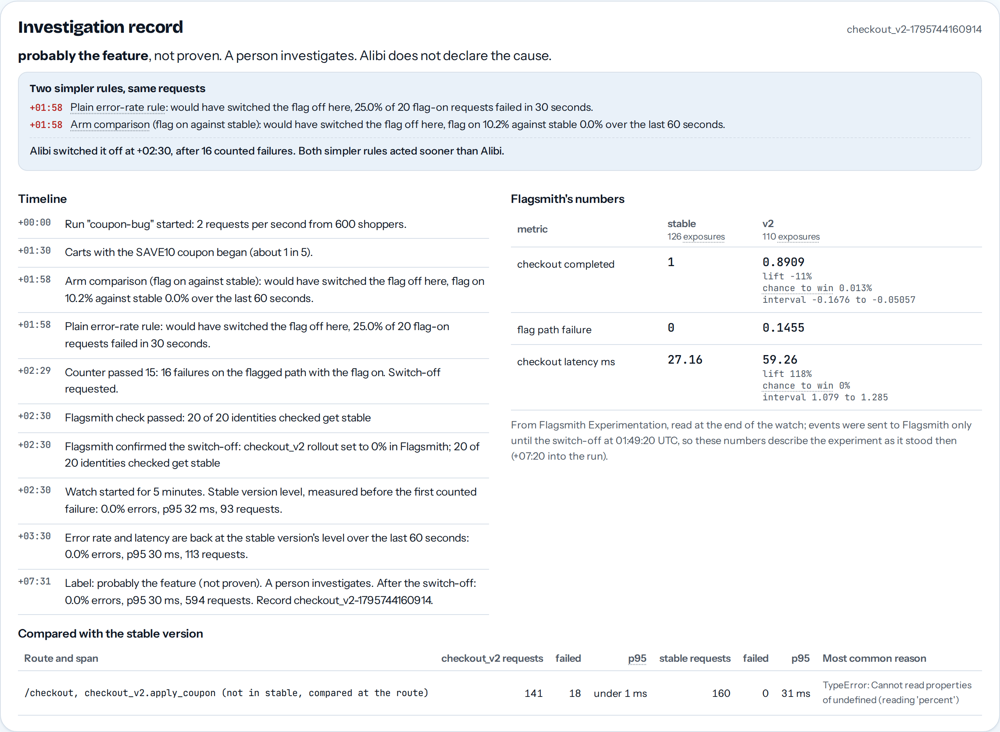
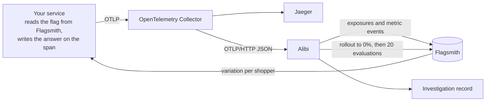

# Alibi: was it the flag, or was the database down?

Alibi switches a Flagsmith feature off only when the feature's own code is failing, and tells you why it thinks so. It reads the OpenTelemetry traces your service already sends.

[](https://itssaharsh.github.io/alibi/)

**Live page:** https://itssaharsh.github.io/alibi/ (no sign-in; it replays three recorded runs in your browser)
**Track:** 03, Build on Open Source Flagsmith

## The problem

You put a new checkout behind a flag for half your shoppers. Twenty minutes later the error graph jumps, and a kill switch that watches the error rate switches the feature off. But the database was down and the feature was fine. Now you have an outage and a rolled-back launch, and nobody knows which caused what.

The trace already knows. Every failing request says where it failed: in the new checkout's own code, or in a call to something that was down.

## What happened in three recorded runs

These ran on a real stack: self-hosted Flagsmith 2.295.2, a shop instrumented with OpenTelemetry, two requests a second from 600 scripted shoppers, recorded on 27 November 2026.

| Run | What was done to the shop | What Alibi did |
|---|---|---|
| **The database outage** | The database was stopped for 90 seconds | 97 requests with the flag on failed. All 97 failed in `pg.connect`, a dependency call. Alibi counted 0 and left the flag on |
| **The coupon bug** | Carts with a coupon crash inside `checkout_v2.apply_coupon` | Counted each one. At the 16th it set the rollout to 0% in Flagsmith and confirmed 20 of 20 identities got the stable checkout. Errors and latency were back at the stable version's level a minute later. Label: **probably the feature** |
| **The slow host** | The shop's CPU was throttled to a twentieth of a core | The new checkout's own time budget failed 16 times, so the flag went off. Errors stopped, but p95 latency stayed at 330 ms against a stable level of 42 ms. Label: **probably not the feature** |

In the slow-host run the rule did what it says: the feature's own code was failing, so the flag went off. The five-minute watch is how Alibi found out the feature was probably not why.

### Against two simpler rules, on the same requests

Alibi replays every run through two rules that need no traces, and shows what each would have done:

| Run | Plain error-rate rule (flag-on errors over 20% in 30 s) | Arm comparison (flag on against stable over 60 s) | Alibi |
|---|---|---|---|
| The database outage | switches the healthy feature off at +01:16 | at a 10-point margin, switches it off at +01:22 (39.1% against 28.8%); holds only from a 20-point margin up | 0 counted, flag stays on |
| The coupon bug | off at +01:58 | off at +01:58 (10 points) or +02:20 (20 points) | off at +02:30, with the failing span, then "probably the feature" |
| The slow host | off at +01:36 | off at +01:36 (10 points) or +01:44 (20 points) | off at +01:48, then "probably not the feature" |

Read it honestly: on a real bug both simpler rules are faster than Alibi, which waits for 16 failures in the feature's own code. And an arm comparison with a wide enough margin gets all three decisions right. What it needs is that margin, picked in advance: during the outage both variations were failing, and with about 50 requests in each the gap between them reached 19 points on noise alone (at the moment the 10-point rule tripped, 18 of 46 against 19 of 66, the two-proportion p-value is 0.25). Alibi has no margin to pick, because it does not compare rates: each of the 97 failures says it failed in `pg.connect`. That is what reading the trace buys: the reason for every request, and a record that stops at "probably".


## For judges: see it in under a minute

1. Open https://itssaharsh.github.io/alibi/. The first screen is the database outage, already finished: 0 of 97 counted, the flag stays on. Click any tag to see that request's spans and the reason.
2. Press **Replay the database outage**, or pick **The coupon bug** and jump to "The counter passes 15".
3. Or replay a run in your terminal. This needs Node 22 and nothing else:

```bash
git clone https://github.com/itssaharsh/alibi && cd alibi/packages/core
npm install && npm run build
node dist/cli.js replay ../../runs/coupon-bug.jsonl
```

```text
The coupon bug
Planted: Carts with the SAVE10 coupon crash inside the new checkout's own code.
Source: self-hosted Flagsmith 2.295.2, recorded 27 Nov 2026

Timeline
+00:00  Run "coupon-bug" started: 2 requests per second from 600 shoppers.
+01:30  Carts with the SAVE10 coupon began (about 1 in 5).
+01:33  Flag-on request failed on /checkout (trace 9dce3ca3). Failed in checkout_v2.apply_coupon, a span on the flagged path: TypeError: Cannot read properties of undefined (reading 'percent'). Counts toward the switch-off.
        ... 17 more lines like this one, one per failing request ...
+01:58  Arm comparison (flag on against stable): would have switched the flag off here, flag on 10.2% against stable 0.0% over the last 60 seconds.
+01:58  Plain error-rate rule: would have switched the flag off here, 25.0% of 20 flag-on requests failed in 30 seconds.
+02:29  Counter passed 15: 16 failures on the flagged path with the flag on. Switch-off requested.
+02:30  Flagsmith check passed: 20 of 20 identities checked get stable
+02:30  Flagsmith confirmed the switch-off: checkout_v2 rollout set to 0% in Flagsmith; 20 of 20 identities checked get stable
+02:30  Watch started for 5 minutes. Stable version level, measured before the first counted failure: 0.0% errors, p95 32 ms, 93 requests.
+03:30  Error rate and latency are back at the stable version's level over the last 60 seconds: 0.0% errors, p95 30 ms, 113 requests.
+07:31  Label: probably the feature (not proven). A person investigates. After the switch-off: 0.0% errors, p95 30 ms, 594 requests. Record checkout_v2-1795744160914.
+09:00  Run "coupon-bug" ended.

Summary
  Flag-on failures: 18
  Counted toward the switch-off: 16 (the flag goes off above 15)
  Not counted: 0 from a dependency, 0 from the server, 0 mixed
  Plain error-rate rule: would have switched the flag off at +01:58
  Arm comparison (flag on against stable): would have switched the flag off at +01:58, flag on 10.2% against stable 0.0% over the last 60 seconds.
  Result: probably the feature (not proven). A person investigates.
```

The output is shortened in the one place it says so. The page and the command run the same engine on the same recorded spans. Only Flagsmith's answers are replayed from the recording.

## Quickstart: run it yourself

You need Docker with Compose, and Node 22 for the load script. Nothing else is installed on your machine; everything else runs in containers.

```bash
git clone https://github.com/itssaharsh/alibi && cd alibi
docker compose -f deploy/docker-compose.yml up -d --build --wait
node load/run.mjs coupon-bug
```

The first command builds and starts the whole example: self-hosted Flagsmith (it creates the flag, the experiment and its three metrics for you), a small shop, the OpenTelemetry Collector, Jaeger, Alibi and the live board. On our test machine it took about 3 minutes with the images already pulled; a first pull of the images takes longer. It returns when everything reports healthy.

The second command sends two shop requests a second for 9 minutes. Open the board while it runs: **http://127.0.0.1:4173**. This is what you will see:

| Time | What happens |
|---|---|
| 0:00 | Healthy traffic. About half of the shoppers get `v2`, the new checkout. |
| 1:30 | Carts with a coupon begin to crash inside `checkout_v2.apply_coupon`. The board's counter starts to climb. |
| about 2:30 | The counter passes 15. Alibi sets the experiment's rollout to 0% in Flagsmith, checks that 20 of 20 identities now get `stable`, and the board says **switched off**. |
| about 3:30 | Error rate and latency are back at the stable version's level over a full minute. |
| about 7:30 | The five-minute watch ends. The label appears: **probably the feature**, with the investigation record and Flagsmith's own numbers. |

The command prints a summary when it ends. The recording of the run is written inside the Alibi container; copy it out with `docker compose -f deploy/docker-compose.yml cp alibi:/data/runs/coupon-bug.jsonl .` and replay it with the command in the section above.

### The local addresses

| What | Address |
|---|---|
| The live board (add `?live=` to the address to see the three recorded runs instead) | http://127.0.0.1:4173 |
| Flagsmith | http://127.0.0.1:8000 |
| Jaeger, for the traces | http://127.0.0.1:16686 |
| Alibi's own state, as JSON | http://127.0.0.1:4319/api/state |

**Flagsmith login.** The email is `admin@alibi.example`. The password is generated on your machine, the first time you start the stack: it is the `ADMIN_PASSWORD` line in `deploy/data/shared/secrets.env`. To see the experiment, open the organisation Alibi, the project `shop`, the environment `Development`, then **Experiments** and `checkout_v2 rollout`. After the switch-off, "Current rollout" there reads 0%. The experiment's results table fills when its **Refresh** button is pressed or when Alibi reads them, which it does ten seconds before the watch ends. Flagsmith allows one refresh every 5 minutes, so wait for the label before you press it yourself.

### The other two scenarios

```bash
node load/run.mjs outage          # 4 minutes: the shop's database is stopped for 90 seconds
node load/run.mjs degraded-host   # 9 minutes: the shop's CPU is throttled (the "slow host" run)
```

In the outage, the board shows failures counted as dependency failures, the counter stays at 0 and the flag stays on. In `degraded-host`, the flag goes off and the label ends as **probably not the feature**. Each scenario arms Alibi itself, so you do not have to.

### Between runs, and stopping

`node load/run.mjs reset` puts the flag back on for half of the shoppers and removes the CPU limit. Flagsmith keeps the numbers from earlier runs, so for clean experiment numbers start from scratch instead:

```bash
docker compose -f deploy/docker-compose.yml down -v
```

That stops everything and deletes the Flagsmith and shop databases. The generated passwords stay in `deploy/data/shared` and are reused the next time. Port 4173 is for the board; if something of yours uses it, start with `ALIBI_BOARD_PORT=4174` in front of the compose command.

## The author's rule

Alibi is built around a rule I wrote before any code existed. These are my words, and the engine does exactly this:

> 1. Only failures in the feature's own code path count. If a request fails because the server or a dependency is down, that is an infrastructure problem, not the feature, and it does not count toward a rollback. Classify every failing trace by where it failed (a span on the flagged path, or an infrastructure or dependency span) and show why.
> 2. Switch the flag off when more than 15 requests with the flag on have failed on the flagged path.
> 3. The baseline is the previous stable version: compare its metrics at the same failing points (same routes and spans), and show why each one failed.
> 4. After switching off: if error rate and latency return to the previous stable version's level within 5 minutes, label it "probably the feature", not proven, and open an investigation record with the traces. If they do not recover within 5 minutes, label it "probably not the feature". Either way a person investigates; the system never declares the cause on its own.

The rule leaves four things open. These are Alibi's defaults, set in one place (`defaultConfig` in `packages/core/src/guard.ts`) and not part of the rule:

- **"Returned to the stable version's level"** means: over the last 60 seconds, all of them after the switch-off, with at least 20 requests, the error rate is within 2 percentage points of the stable level and p95 latency is within 1.25 times it.
- **The stable level** is measured before the first counted failure, so a host that is already slow cannot pass as "back to normal".
- **A request counts** only when every span where an error started is on the flagged path.
- **A dependency called from the flagged path** does not count when it was unavailable (refused, timed out, 5xx). It does count when it rejected the call (4xx, a syntax error), because then the call was wrong.

## How Flagsmith is used

Take Flagsmith out and nothing is left. It decides who gets the feature, it is the switch, and it holds the comparison.

| Flagsmith feature | What it does here | Where |
|---|---|---|
| Self-hosted Flagsmith in Docker | The whole example runs against your own Flagsmith, created and configured by a bootstrap container | `deploy/docker-compose.yml`, `deploy/bootstrap/bootstrap.sh` |
| Multivariate flag with keyed variations | `checkout_v2` gives each shopper `stable` or `v2`. The shop reads it with a plain flag call | `packages/otel-helpers/src/index.js` |
| Experimentation: exposures and metrics | Alibi turns spans into exposure events and three metric events (`checkout_completed`, `flag_path_failure`, `checkout_latency_ms`). The shop has no tracking call of its own | `packages/guard/src/service.ts` (the events), `packages/guard/src/forwarder.ts` (the batches) |
| Experiment rollout, through the Admin API | The switch. Alibi sets the experiment's rollout to 0%, then evaluates 20 identities and requires every one to get `stable` before it reports the switch-off | `packages/guard/src/flagsmith.ts` |
| Experiment results | Flagsmith's own numbers per variation go into the investigation record | the record on the live page |

In the coupon run, Flagsmith's engine, fed only from spans, gave the new checkout a 0.013% chance of beating the stable one on completed checkouts (89.1% against 100%; lift −10.9%, interval −16.8% to −5.1%). In the outage run it could not tell them apart (70.2% against 75.9%, 11% chance), which is the right answer: nothing was wrong with the feature.



One thing we learned from Flagsmith 2.295.2 while building this: disabling a feature that is in a running experiment does not change what identities receive. The experiment's rollout is the switch, so that is what Alibi sets, and it never reports a switch-off that an evaluation did not confirm.

## How it works



- Your service evaluates the flag and puts the answer on the span as a `feature_flag.evaluation` event. Alibi never decides a variation.
- You wrap the feature's code in one span that carries `alibi.flagged_path=<flag>`.
- The collector you already run gets one more exporter.
- For each failing request, Alibi finds the span where the error started and classes the request: flagged path, dependency, server, or mixed. It writes one sentence from that span's own fields, for example: "Failed in pg.connect, a dependency call (db.system.name=postgresql): Connection terminated unexpectedly. The dependency was unavailable, so this does not count."
- The engine (`packages/core`) is pure TypeScript with no dependencies. The guard service and the page run the same code, and 146 tests pin its sentences word for word, including on spans captured from the real stack and on the three recorded runs.

The attribute names follow OpenTelemetry's feature-flag semantic conventions, which are still a release candidate, so this is not a conformance claim.

## Use it with your own service

Point one more exporter at Alibi:

```yaml
exporters:
  otlphttp/alibi:
    endpoint: http://alibi:4319
    encoding: json
service:
  pipelines:
    traces:
      exporters: [otlp/jaeger, otlphttp/alibi]
```

Put the flag's answer on the span, and run the feature inside a marked span. This is the whole integration (`packages/otel-helpers` has both helpers for Node):

```js
const variation = await evaluateFlag({ flagsmith, flag: 'checkout_v2', userId, fallback: 'stable' });
if (variation === 'v2') {
  return runFlagged('checkout_v2', 'checkout_v2', () => newCheckout(cart));
}
return stableCheckout(cart);
```

Alibi's settings are environment variables, listed in `packages/guard/README.md`.

## What is real

| Part | Status |
|---|---|
| Flagsmith, the flag, the experiment, the switch-off and its confirmation | real: self-hosted Flagsmith 2.295.2 |
| The spans, the Postgres errors, the CPU throttle, the timings | real: recorded on 27 November 2026, replayed unchanged |
| The shop and its shoppers | scripted |
| Protobuf OTLP, more than one guarded flag at a time | not built |

## Built with

Built during Toggle Wars, 27 to 29 November 2026. AI coding assistants wrote most of the code under my direction. The guardrail rule, and the calls on what counts, are mine.

MIT licence.
